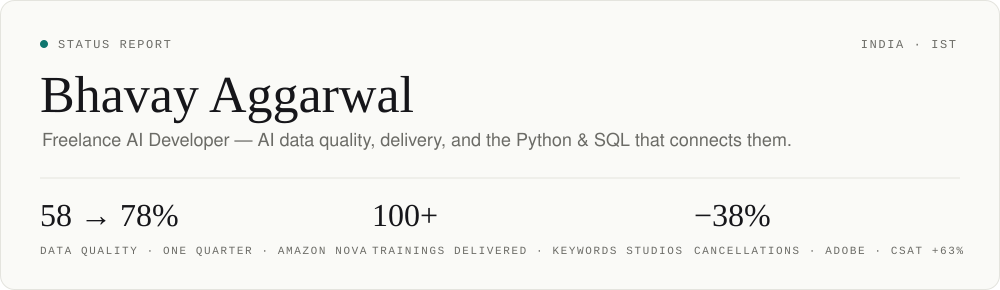

<picture>
  <source media="(prefers-color-scheme: dark)" srcset="./assets/header-dark.svg">
  
</picture>

  <a href="https://bhavayaggwal.github.io/Portfolio/">Portfolio</a> ·
  <a href="https://www.linkedin.com/in/bhavay-aggarwal2003/">LinkedIn</a> ·
  <a href="mailto:agg.bhavay@gmail.com">Email</a> ·
  <a href="https://bhavayaggwal.github.io/Portfolio/uploads/Bhavay_Aggarwal_Data_Science_Resume.docx">CV</a> ·
  <a href="https://bhavayaggwal.github.io/Portfolio/llms.txt">llms.txt</a>

 

I run AI data and delivery work for cross-functional teams, and use Python, SQL and AI to turn KPI data into delivery decisions rather than just reporting on them. Most recently: AI Project Lead at FlixStock, and before that leading a 30+ person research team on Amazon's Nova agentic-AI data at Keywords Studios.

**Now** — building [SceneForge](https://github.com/bhavayaggwal/SceneForge), working toward PMP, and open to AI programme and delivery roles.

 

### Selected work

| Project | What it does | Built with |
| :-- | :-- | :-- |
| [**SceneForge**](https://github.com/bhavayaggwal/SceneForge) | Turns a short phone video into an editable, photoreal 3D scene; swap objects with natural-language prompts, export for AR. *In development.* | JavaScript · 3D reconstruction |
| [**Real-Time ASL Translation**](https://github.com/bhavayaggwal/Real-Time-Sign-Language-Translation) | Reads American Sign Language characters from a webcam and translates them live. 95% recognition on 30,000+ images. | TensorFlow · OpenCV · CNN |
| [**Fashion Recommendation Engine**](https://github.com/bhavayaggwal/Fashion-Recommendation-System) | Image-based recommendations; written up as a peer-reviewed book chapter (ISBN 9781032798110). | Python · Deep learning |
| [**Business Startup Simulator**](https://github.com/bhavayaggwal/Business-Simulator) | Desktop sim that shows how price, marketing and stock move revenue, profit and cash — and why a profitable business can still run out of cash. | Python · PyQt6 · SQL Server |

 

### Experience

| | |
| :-- | :-- |
| **AI Project Lead** · FlixStock | Aug 2026 – Oct 2026 |
| **Senior Research Associate** · Keywords Studios | Jan 2026 – Aug 2026 |
| **Technical Research Associate** · Keywords Studios | Apr 2025 – Dec 2025 |
| **Customer Service Associate** · Adobe, via Teleperformance | Sep 2024 – Mar 2025 |

 

### Toolkit

**Data & AI** &nbsp; `Python` `SQL` `TensorFlow` `OpenCV` `Power BI` `Claude` `LLM APIs`
 
**Delivery** &nbsp; `Agile` `Waterfall` `Jira` `Asana` `CI/CD` `KPI analysis`

 

### Recognition

- **World Champion**, Microsoft Imagine Cup Junior 2021
- **Book chapter** — *AI-Driven Fashion Item Recommendation Systems* (ISBN 9781032798110)
- **Journal paper** — *Geo-processing with Python* (ISSN 2320-2882)
- **MCA**, Amity University · **BCA**, GGS Indraprastha University (CGPA 8.96)
